# OpenDayCare

Portal web en español para una guardería. Tiene dos roles (`staff` y `family`), autenticación real
con Supabase Auth (email y contraseña) y datos persistentes de niños, salas e invitaciones. La UI se
construye a partir de las maquetas de `references/pantallas/*.dc.html`.

[](https://nextjs.org/docs)
[](https://react.dev/)
[](https://www.typescriptlang.org/docs/)
[](https://tailwindcss.com/docs)
[](https://supabase.com/docs)

- **Repositorio:** <https://github.com/Nruz-app/open-code-daycare-app>
- **Stack:** Next.js 16 · React 19 · TypeScript 5 · Tailwind CSS 4 · Supabase
- **Idioma del producto:** español (textos, mensajes de error y comentarios del código)
- **Estado:** funcional para el rol `staff` (login real, feed, niños, alta e invitaciones). El portal
  de familias y la persistencia de publicaciones siguen pendientes.

> Este README es el manual completo. Para las reglas operativas de los agentes de IA, consulta
> [`AGENTS.md`](./AGENTS.md) y [`CLAUDE.md`](./CLAUDE.md).

---

## Capturas

Tomadas de la aplicación real con `npm run build && npm run start`, sesión de staff demo y datos
seedeados (escritorio 1440×900, móvil 390×844).

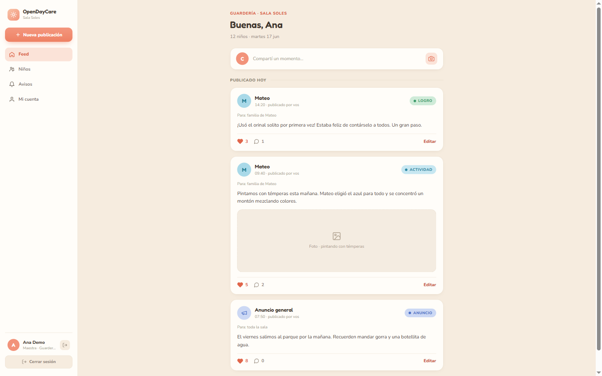

| Escritorio | Móvil |
| --- | --- |
| 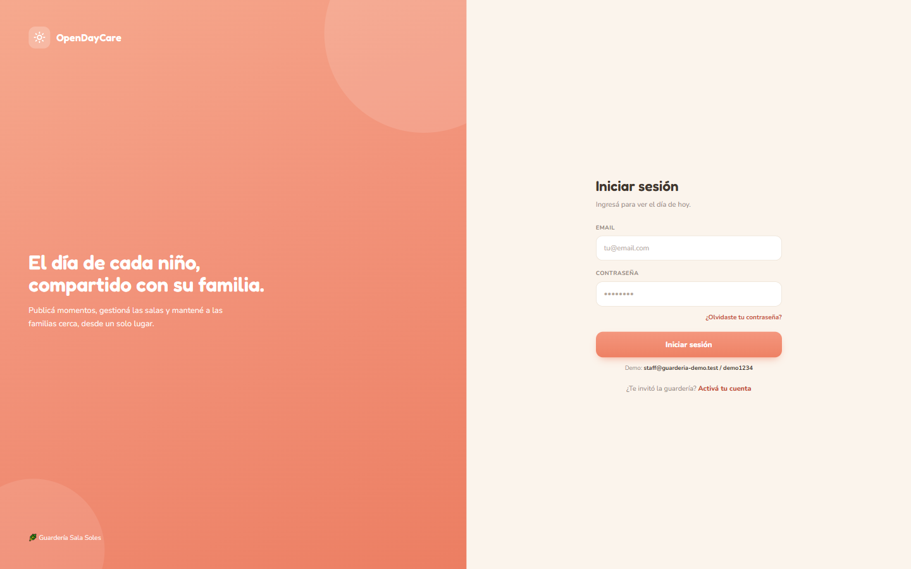 | 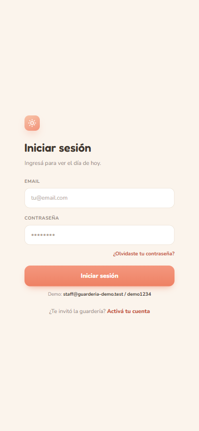 |
| 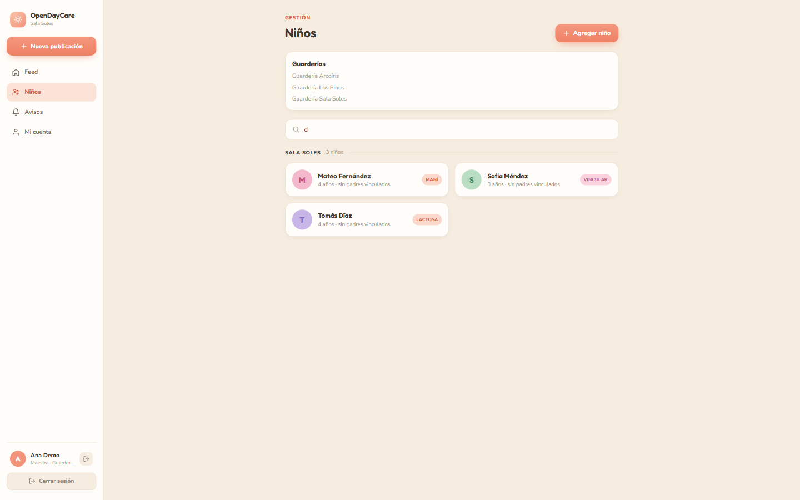 | 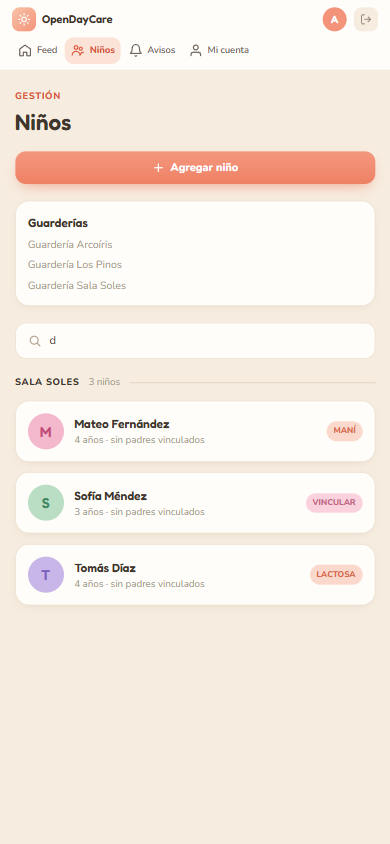 |
| 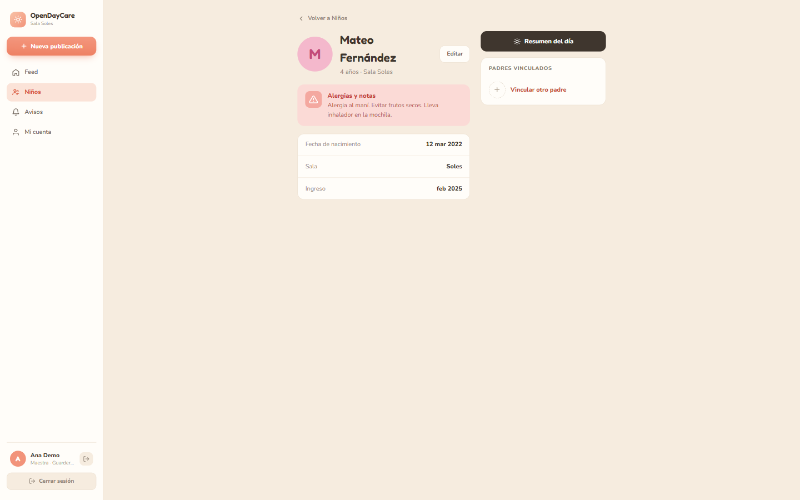 | 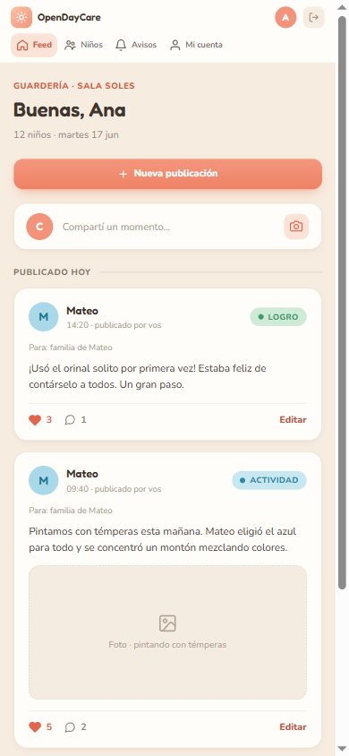 |
| 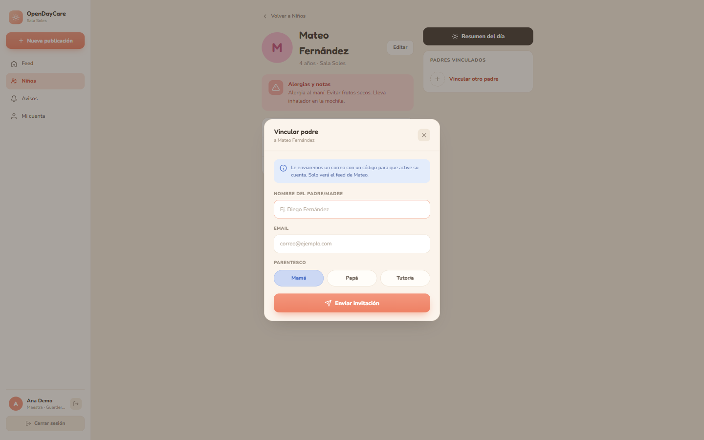 | 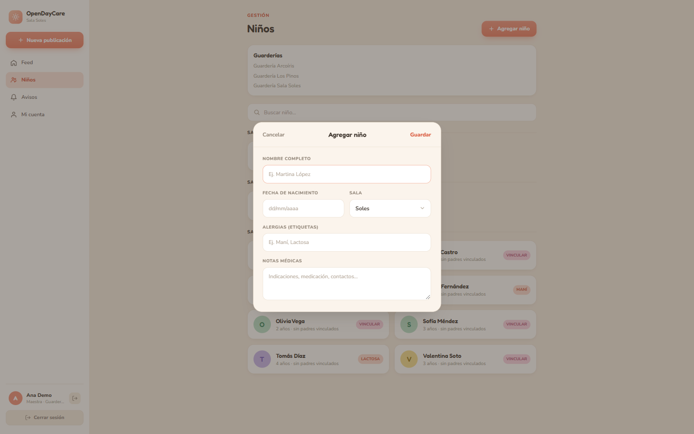 |

Las capturas viven en [`docs/capturas/`](./docs/capturas) y **sí se versionan**: son las que GitHub
muestra en este README. Las capturas de trabajo de Playwright siguen en `.playwright-mcp/`, que está
ignorado por Git.

---

## Índice

1. [Qué incluye](#qué-incluye)
2. [Stack y versiones](#stack-y-versiones)
3. [Requisitos](#requisitos)
4. [Instalación rápida](#instalación-rápida)
5. [Variables de entorno](#variables-de-entorno)
6. [Scripts](#scripts)
7. [Estructura del proyecto](#estructura-del-proyecto)
8. [Arquitectura](#arquitectura)
9. [Rutas y roles](#rutas-y-roles)
10. [Autenticación y sesión](#autenticación-y-sesión)
11. [Base de datos y migraciones](#base-de-datos-y-migraciones)
12. [Datos de la aplicación](#datos-de-la-aplicación)
13. [Diseño y sistema visual](#diseño-y-sistema-visual)
14. [Flujo de specs](#flujo-de-specs)
15. [Agentes, comandos y skills](#agentes-comandos-y-skills)
16. [MCP: Playwright, Supabase y Context7](#mcp-playwright-supabase-y-context7)
17. [Agente de OpenCode en GitHub](#agente-de-opencode-en-github)
18. [Verificación y calidad](#verificación-y-calidad)
19. [Solución de problemas](#solución-de-problemas)
20. [Pendientes y siguiente alcance](#pendientes-y-siguiente-alcance)
21. [Enlaces oficiales](#enlaces-oficiales)
22. [Licencia](#licencia)

---

## Qué incluye

Implementado y navegable:

- `/login` — acceso real con email y contraseña (Supabase Auth). Muestra las credenciales demo.
- `/activar-cuenta` — maqueta del flujo de activación de una familia (datos fijos, no persiste).
- `/feed` — home del personal con sidebar, composer, diálogo de publicación y tres publicaciones de
  ejemplo (`const posts`, sin persistencia).
- `/ninos` — listado real de niños desde `children`, agrupado por sala, buscador que ignora
  mayúsculas y acentos, y alta de niño que inserta en Supabase.
- `/ninos/[id]` — perfil desde `children` con notas médicas, alergias, padres vinculados y el
  diálogo para invitar a otro padre. Usa uuid reales; 404 si el niño no existe.
- `/` — el proxy redirige al home del rol (`/feed` para `staff`, `/familia-feed` para `family`).

Registrado en `app/lib/routes.ts` pero **sin pantalla propia** (se resuelven con diálogos o están
pendientes): `/agregar-nino`, `/crear-publicacion` y `/vincular-padre` son diálogos; `/avisos`,
`/resumen-dia`, `/familia-feed` y `/familia-cuenta` no tienen página.

Todavía **no** existe:

- Portal funcional de familias (las rutas están registradas, sin pantalla).
- Persistencia del feed: publicaciones, comentarios y reacciones son diseño; las tablas existen pero
  no tienen políticas RLS y la app no las consulta.
- Envío real de correos: la invitación persiste la fila y el código, pero no se manda email.
- Tests automatizados. La verificación se hace con lint, `tsc`, `build` y Playwright MCP.

---

## Stack y versiones

| Tecnología | Versión declarada | Versión instalada | Documentación |
| --- | --- | --- | --- |
| Next.js | `16.4.5` | `16.4.5` | <https://nextjs.org/docs> |
| React / React DOM | `19.3.0` | `19.3.0` | <https://react.dev/> |
| TypeScript | `^5` | `5.9.3` | <https://www.typescriptlang.org/docs/> |
| Tailwind CSS | `^4` | `4.3.5` | <https://tailwindcss.com/docs> |
| `@tailwindcss/turbopack` | `^4` | `4.3.5` | <https://tailwindcss.com/docs/installation/framework-guides/nextjs> |
| `@supabase/ssr` | `^0.12.7` | `0.12.7` | <https://supabase.com/docs/guides/auth/server-side/nextjs> |
| `@supabase/supabase-js` | `^2.119.0` | `2.119.0` | <https://supabase.com/docs/reference/javascript> |
| ESLint | `^9` | `9.39.5` | <https://eslint.org/docs/latest/> |
| Node.js | `>=20.9.0` (requisito de Next) | probado con `22.23.4` | <https://nodejs.org/en/download> |
| OpenCode (agente) | — | `2.2.5` en este entorno | <https://opencode.ai/docs/> |

Notas de versión:

- El proyecto usa convenciones de **Next.js 16**. En esta versión `middleware.ts` está deprecado y
  el archivo de intercepción se llama `proxy.ts`.
- Tailwind es **v4 CSS-first**: no hay `tailwind.config.*` ni configuración de PostCSS. Los tokens
  viven en `app/globals.css` con `@theme inline`.
- `next.config.ts` activa `cacheComponents`, `partialPrefetching`, `experimental.agentFeedback` y el
  loader de `@tailwindcss/turbopack`.

---

## Requisitos

- **Node.js 20.9 o superior** y npm. El proyecto usa `package-lock.json`, así que el gestor previsto
  es **npm**.
- Git.
- Un proyecto de **Supabase** con el esquema migrado (o acceso al proyecto del equipo) y sus dos
  variables públicas.
- Opcional para trabajar con agentes:
  - **OpenCode** (CLI, escritorio o web): <https://opencode.ai/docs/>
  - **Context7 MCP** para documentación actualizada de librerías: <https://context7.com>
  - **Playwright MCP** para navegar y verificar pantallas:
    <https://github.com/microsoft/playwright-mcp>

---

## Instalación rápida

### 1. Clonar e instalar dependencias

```bash
git clone https://github.com/Nruz-app/open-code-daycare-app.git
cd open-code-daycare-app
npm install
```

### 2. Crear el archivo de entorno

**PowerShell (Windows):**

```powershell
Copy-Item .env.example .env.local
```

**Bash (Linux/macOS):**

```bash
cp .env.example .env.local
```

Rellena las dos variables con los valores del proyecto Supabase
(**Project Settings → API / Data API**):

```dotenv
NEXT_PUBLIC_SUPABASE_URL=https://<proyecto>.supabase.co
NEXT_PUBLIC_SUPABASE_PUBLISHABLE_KEY=<publishable-key>
```

`.env.local` está ignorado por Git. **No lo subas al repositorio.** Sin estas variables fallan el
cliente de servidor y el refresh de sesión de `proxy.ts`.

### 3. Arrancar el servidor de desarrollo

```bash
npm run dev
```

Abre <http://localhost:3000>. Sin sesión, el proxy redirige a `/login`.

### 4. Entrar con el usuario demo

| Rol | Email | Contraseña |
| --- | --- | --- |
| `staff` (Ana Demo, Guardería Sala Soles) | `staff@guarderia-demo.test` | `demo1234` |

Las credenciales también aparecen en la propia pantalla de login. No crees usuarios desde el
formulario de alta: el perfil lo crea el trigger `handle_new_user`.

### 5. Verificar la instalación

```bash
npm run lint
npx tsc --noEmit
npm run build
```

`npm run lint` arrastra deuda preexistente fuera de `app/` (ver
[Verificación y calidad](#verificación-y-calidad)).

---

## Variables de entorno

| Variable | Obligatoria | Descripción |
| --- | --- | --- |
| `NEXT_PUBLIC_SUPABASE_URL` | Sí | URL del proyecto Supabase. |
| `NEXT_PUBLIC_SUPABASE_PUBLISHABLE_KEY` | Sí | Clave pública (publishable / anon) del proyecto. |

Plantilla en [`.env.example`](./.env.example). No hay `SESSION_SECRET`: la cookie HMAC propia se
eliminó con la SPEC 09 y la sesión vive en las cookies `sb-*` de Supabase.

---

## Scripts

| Comando | Qué hace | Equivalente manual |
| --- | --- | --- |
| `npm run dev` | Servidor de desarrollo en el puerto 3000 con Turbopack. | `next dev` |
| `npm run build` | Build de producción. | `next build` |
| `npm run start` | Sirve el build de producción. | `next start` |
| `npm run lint` | ESLint con flat config desde la raíz. | `eslint` |
| `npx tsc --noEmit` | Typecheck sin emitir archivos. No hay script `typecheck`. | `tsc --noEmit` |

No hay runner de tests configurado. **No ejecutes `npm test`**: no existe. La verificación funcional
se hace con Playwright MCP.

---

## Estructura del proyecto

```text
open-daycare/
├── app/
│   ├── activar-cuenta/page.tsx       # Maqueta de activación de cuenta familiar (datos fijos)
│   ├── components/
│   │   ├── app-sidebar.tsx           # Sidebar del staff (Feed, Niños, Avisos, Mi cuenta)
│   │   ├── logout-button.tsx         # Server Action de logout en un formulario
│   │   └── nueva-publicacion-provider.tsx  # Provider servidor del diálogo de publicación
│   ├── feed/
│   │   ├── page.tsx                  # Home del staff (protegido, posts mock)
│   │   └── crear-publicacion.tsx     # Diálogo de publicación (no persiste)
│   ├── lib/
│   │   ├── dal.ts                    # Data Access Layer y tipos de UI
│   │   ├── fecha-nacimiento.ts       # Máscara y validación de dd/mm/aaaa
│   │   └── routes.ts                 # PUBLIC_ROUTES, STAFF_ONLY, FAMILY_ONLY, HOME_BY_ROLE
│   ├── login/
│   │   ├── actions.ts                # Server Actions login y logout (Supabase Auth)
│   │   ├── login-form.tsx            # Formulario cliente con useActionState
│   │   └── page.tsx                  # Pantalla de acceso (Suspense + searchParams)
│   ├── ninos/
│   │   ├── [id]/page.tsx             # Perfil del niño (instant = false)
│   │   ├── actions.ts                # Server Actions altaNino e invitarPadre
│   │   ├── agregar-nino.tsx          # Diálogo de alta (persiste)
│   │   ├── gestion-ninos.tsx         # Cliente: buscador, tarjetas y grupos por sala
│   │   ├── layout.tsx                # Envuelve niños con el provider de publicación
│   │   ├── page.tsx                  # Listado desde children + alta
│   │   └── vincular-padre.tsx        # Diálogo de invitación (persiste)
│   ├── globals.css                   # Tailwind v4 + tokens de diseño
│   ├── layout.tsx                    # Fuentes Fredoka/Nunito y metadata
│   └── page.tsx                      # Redirect de respaldo a /feed
├── docs/capturas/*.png               # Capturas de este README (versionadas)
├── references/
│   ├── pantallas/*.dc.html           # Maquetas HTML de referencia
│   ├── screenshots/*.png             # Capturas de referencia de las maquetas
│   └── DB-Schema/…md                 # Diccionario de 13 tablas
├── specs/                            # Specs 01–11 del flujo spec-driven
├── supabase/migrations/*.sql         # 20 migraciones aplicadas por MCP
├── utils/supabase/                   # Scaffold @supabase/ssr: client, server y proxy
├── .agents/skills/                   # Skills del proyecto (spec, spec-impl, apoyo)
├── .claude/skills/                   # Compatibilidad con Claude Code
├── .opencode/
│   ├── agents/*.md                   # spec-verify, db-migrator, db-security-auditor, …
│   └── commands/*.md                 # /spec, /spec-impl, /spec-imp, /spec-verify, /db-migrate
├── .github/workflows/opencode.yml    # Agente de OpenCode en GitHub
├── .playwright-mcp/                  # Capturas de trabajo de Playwright (ignorado)
├── proxy.ts                          # "Middleware" de Next 16 (runtime Node.js)
├── next.config.ts                    # cacheComponents, partialPrefetching, Turbopack
├── skills-lock.json                  # Procedencia y hash de las skills
├── AGENTS.md                         # Notas operativas para agentes
├── CLAUDE.md                         # Punto de entrada para Claude Code
└── README.md
```

Alias de importación: `@/*` apunta a la raíz del repositorio (`tsconfig.json`). Por eso los imports
son `@/app/lib/...`, **no** `@/lib/...`.

---

## Arquitectura

### Capas de la aplicación

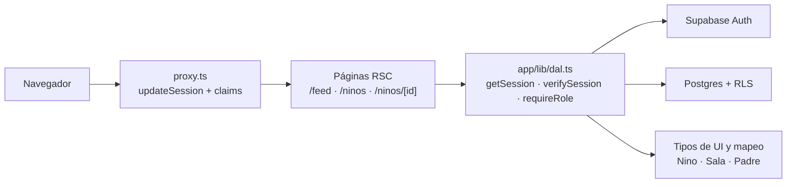

`proxy.ts` solo hace comprobaciones **optimistas** con los claims del JWT. La autorización real (y la
única puerta a los datos) es `app/lib/dal.ts`. Ninguna página ni componente llama a Supabase por su
cuenta.

### Flujo de autenticación

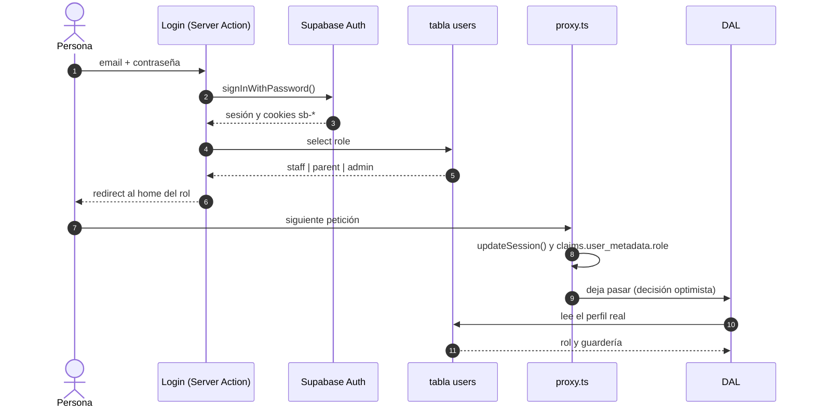

### Enrutamiento deny-by-default

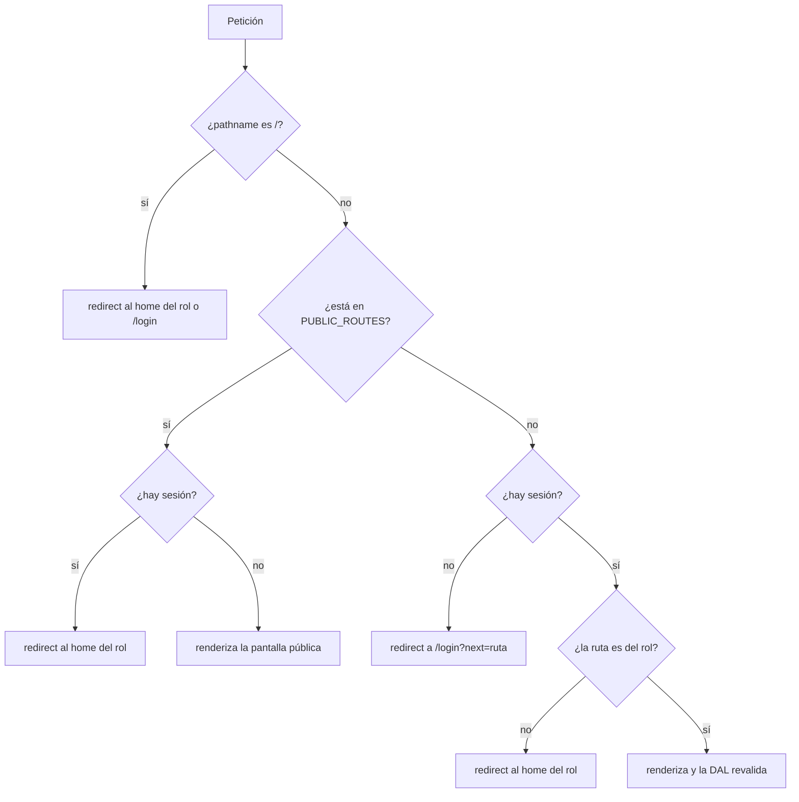

---

## Rutas y roles

La configuración vive en [`app/lib/routes.ts`](./app/lib/routes.ts). El enrutamiento es
**deny-by-default**: todo lo que no está en `PUBLIC_ROUTES` exige sesión. El matching es exacto o por
prefijo de segmento (`/ninos/123` coincide, `/ninos-x` no).

### Rutas públicas

| Ruta | Estado | Descripción |
| --- | --- | --- |
| `/login` | Implementada | Acceso real con Supabase Auth. |
| `/activar-cuenta` | Implementada (maqueta) | Activación de invitación familiar, sin persistencia. |
| `/vincular-padre` | Registrada, sin página | El flujo real es el diálogo del perfil del niño. |

### Rutas del personal (`staff`)

| Ruta | Estado | Descripción |
| --- | --- | --- |
| `/feed` | Implementada | Home del personal. |
| `/ninos` | Implementada | Listado real de niños y alta. |
| `/ninos/[id]` | Implementada | Perfil del niño e invitaciones. |
| `/agregar-nino` | Registrada; se usa el diálogo de `/ninos` | Alta de niño. |
| `/crear-publicacion` | Registrada; se usa el diálogo del feed | Crear publicación. |
| `/resumen-dia` | Registrada, sin página | Resumen diario. |
| `/avisos` | Registrada, sin página | Avisos. |

### Rutas de familias (`family`)

| Ruta | Estado | Descripción |
| --- | --- | --- |
| `/familia-feed` | Registrada, sin página | Feed de la familia. |
| `/familia-cuenta` | Registrada, sin página | Cuenta de la familia. |

### Homes por rol

| Rol de la app | Rol en la DB | Home |
| --- | --- | --- |
| `staff` | `staff`, `admin` | `/feed` |
| `family` | `parent` | `/familia-feed` |

**Importante:** si agregas una ruta pública o restringida, regístrala en `PUBLIC_ROUTES`,
`STAFF_ONLY`, `FAMILY_ONLY` o `HOME_BY_ROLE`. Las rutas protegidas nuevas no necesitan cambios en
`proxy.ts`.

La sidebar enlaza "Avisos" y "Mi cuenta" a `#`: son enlaces de maqueta, no rutas reales.

---

## Autenticación y sesión

Hay dos capas, y solo una es la frontera real de autorización:

1. **`proxy.ts` (optimista).** Llama a `updateSession()` de `utils/supabase/proxy.ts`, lee
   `user_metadata.role` de los claims (`staff|admin` → `staff`, `parent` → `family`) y aplica
   redirecciones:
   - `/` → home del rol o `/login`.
   - Ruta protegida sin sesión → `/login?next=<ruta>`.
   - Sesión válida en `/login` o `/activar-cuenta` → home del rol.
   - `staff` en ruta `FAMILY_ONLY` → `/feed`; `family` en `STAFF_ONLY` → `/familia-feed`.
2. **`app/lib/dal.ts` (autorización real).** Antes de tocar datos:
   - `getSession()` — devuelve `Perfil | null` sin redirigir. Usa `getUser()`, que valida el token
     contra el servidor de Auth, y lee el perfil de `users` con RLS `users_select_own`.
   - `verifySession()` — exige sesión y redirige a `/login`.
   - `requireRole("staff" | "family")` — exige rol; redirige al home del rol si no coincide.

Reglas no obvias:

- Un usuario autenticado **sin fila en `users`** se trata como no autenticado (falla cerrado).
- `mapearRol` traduce el enum `user_role` (`staff | parent | admin`) a los roles de la app
  (`staff | family`).
- `login` valida `?next=` con `destinoSeguro`: solo acepta rutas internas del rol autenticado
  (anti open redirect).
- `logout` vive en `app/login/actions.ts` (`signOut` + redirect a `/login`).
- La sesión son las cookies `sb-*` de Supabase; no hay cookie propia ni `SESSION_SECRET`.

### Login demo

`staff@guarderia-demo.test` / `demo1234`, con perfil en `users` vinculado a "Guardería Sala Soles".
La pantalla de login muestra estas credenciales y está pensada para desarrollo y pruebas.

---

## Base de datos y migraciones

- Proyecto Supabase: `btknjzobaqtekofvfsof`.
- Diccionario completo en
  [`references/DB-Schema/opendaycare-database-schema.md`](./references/DB-Schema/opendaycare-database-schema.md).
  Es el objetivo de diseño; el estado real está en `supabase/migrations/`.
- Las 13 tablas del diccionario ya existen. Las migraciones se aplican por MCP
  (`tools.supabase.apply_migration`) y el historial vive en Supabase, no solo en el repo.

### Modelo de datos (dominio implementado)

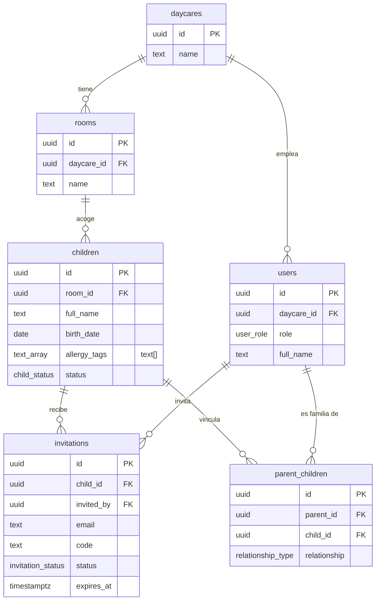

`users.id` referencia `auth.users.id`; el perfil lo crea el trigger `handle_new_user`.

### Migraciones aplicadas (20)

| Bloque | Archivos | Contenido |
| --- | --- | --- |
| SPEC 06–07 | `create_daycares`, `seed_daycares`, `create_users`, `create_user_profile_trigger`, `seed_staff_user`, `harden_user_functions`, `revoke_handle_new_user_execute` | Guarderías, usuarios, trigger de perfil y usuario demo. |
| SPEC 08–09 | `daycares_public_read`, `users_select_own` | Lectura pública de guarderías y RLS del perfil propio. |
| SPEC 10 | `create_enums`, `create_rooms_children`, `create_parent_children_invitations`, `create_posts_tables`, `create_interactions`, `create_daily_summaries_devices`, `enable_rls_all`, `rooms_children_staff_rls`, `seed_rooms`, `seed_children` | Dominio completo, RLS por guardería y datos seed. |
| SPEC 11 | `invitations_staff_rls` | Políticas de invitaciones por guardería. |

### Convenciones para migraciones

- Archivo `supabase/migrations/YYYYMMDDHHMMSS_snake_case.sql`, con el timestamp UTC de creación y
  un solo cambio lógico por archivo.
- DDL/DML plano: sin `if not exists`, sin `drop` y sin `begin`/`commit` manual.
- **Todo lo persistido va en inglés** (enums, tags); las etiquetas visibles se traducen en la UI.
- Se aplican con `tools.supabase.apply_migration({ name, query })`. `name` es el slug sin timestamp
  (`create_daycares`); `apply_migration` asigna su propio `version`, que no coincide con el prefijo
  del archivo. Empareja por `name`.
- Una migración aplicada **no se edita**: cualquier corrección va en un archivo nuevo.
- `tools.supabase.list_migrations()` es la fuente para saber qué se aplicó.
- El comando `/db-migrate` (subagente `db-migrator`) audita repo ↔ Supabase y aplica pendientes.

### Estado de RLS

Habilitada en todas las tablas, pero solo estas tienen políticas:

| Tabla | Políticas |
| --- | --- |
| `daycares` | Lectura pública. |
| `users` | `users_select_own` (cada persona lee su perfil). |
| `rooms` | Staff de la guardería. |
| `children` | Staff de la guardería (select e insert). |
| `invitations` | Staff de la guardería (select, insert y update de pendientes). |

Sin políticas (la app no puede leerlas ni escribirlas): `posts`, `comments`, `reactions`,
`post_children`, `post_photos`, `parent_children`, `daily_summaries` y `devices`.

**Consecuencia visible:** `getNinos` embebe `parent_children(...)`, pero al no haber política el
resultado llega vacío y todos los niños muestran "sin padres vinculados". No es un bug de la UI: falta
la migración de RLS. Tablas sin políticas disparan el aviso informativo `rls_enabled_no_policy` en
Supabase.

---

## Datos de la aplicación

- **Feed:** `const posts` en `app/feed/page.tsx`. Tres publicaciones mock (logro, actividad y
  anuncio); no persiste y "Editar" apunta a `#`.
- **Niños, salas y guarderías:** reales, desde Supabase vía la DAL (`getNinos`, `getNinoPorId`,
  `getSalas`, `getDaycares`).
- **Alta:** `altaNino` → `crearNino` valida, inserta en `children` y hace `revalidatePath("/ninos")`.
- **Invitaciones:** `invitarPadre` → `crearInvitacion` cancela las pendientes del mismo email y niño,
  inserta en `invitations` con `invited_by` tomado del perfil, código único de 5 caracteres
  (alfabeto sin `I`, `O`, `0`, `1`; reintenta ante colisión `23505`) y vencimiento a 7 días. El correo
  es simulado.
- **Fechas:** `app/lib/fecha-nacimiento.ts` maneja la máscara y validación `dd/mm/aaaa`; a la DB van
  en ISO.
- **Mapeos:** la DAL traduce lo persistido al español de la UI: alergias (`peanut` → `MANÍ`,
  `lactose` → `LACTOSA`, …) y parentesco (`mother` → `Mamá`, `father` → `Papá`, `guardian` →
  `Tutor/a`). Sin tipos generados, las filas se castean (`as unknown as`) y los embeds pueden llegar
  como objeto o como lista.
- El encabezado del feed ("12 niños · martes 17 jun") es texto fijo y no se calcula de la base.

---

## Diseño y sistema visual

La referencia visual es `references/pantallas/`. Las capturas de `references/screenshots/` muestran
las maquetas; las de `docs/capturas/` muestran la app real.

### Tipografías

- **Fredoka** para títulos (`font-display`).
- **Nunito** para texto (`font-sans`).
- Ambas se cargan con `next/font/google` en `app/layout.tsx` y se exponen como variables CSS.

### Tokens principales (`app/globals.css`)

| Token | Valor | Uso |
| --- | --- | --- |
| `--color-cream` | `#f6ecdf` | Fondo general |
| `--color-surface` | `#fffdf9` | Tarjetas |
| `--color-paper` | `#fbf4ec` | Fondo de pantallas de acceso |
| `--color-line` | `#ece0d0` | Bordes |
| `--color-ink` | `#3f362e` | Texto principal |
| `--color-ink-muted` | `#94887b` | Texto secundario |
| `--color-coral` | `#ee8164` | Acento principal |
| `--color-coral-deep` | `#d9583c` | Acento fuerte |
| `--color-sky` | `#a9d9e8` | Actividad |
| `--color-mint` | `#3e9b6c` | Logro |
| `--color-lilac` | `#4e72c8` | Anuncio |
| `--radius-card` | `20px` | Tarjetas |
| `--shadow-card` | `0 4px 16px -12px rgba(120, 90, 60, 0.5)` | Sombra de tarjeta |

Los tokens se usan como utilidades de Tailwind: `bg-cream`, `text-ink`, `font-display`,
`rounded-card`, `shadow-card`, etc.

### Reglas de diseño

- No agregues `tailwind.config.*` ni PostCSS: Tailwind v4 es CSS-first.
- Mantén la paleta cálida y los radios/sombras existentes.
- Compara cada pantalla con su `.dc.html` y con las capturas de referencia.
- Los textos visibles van en español.
- El overlay de Next Dev Tools no cuenta como diferencia: para capturas "públicas" usa el build de
  producción.

---

## Flujo de specs

El proyecto usa el método **spec-driven**: primero se escribe una spec verificable, luego se aprueba
y solo entonces se implementa.

### Specs existentes

| Spec | Estado | Fecha | Tema |
| --- | --- | --- | --- |
| [`01-diseno-feed-home.md`](./specs/01-diseno-feed-home.md) | Implementado | 2026-11-09 | Feed y base visual |
| [`02-diseno-ninos-perfil.md`](./specs/02-diseno-ninos-perfil.md) | Implementado | 2026-11-10 | Niños y perfil |
| [`03-login-activar-cuenta.md`](./specs/03-login-activar-cuenta.md) | Implementado | 2026-11-10 | Login y activación |
| [`04-vincular-padre.md`](./specs/04-vincular-padre.md) | Implementado | 2026-11-10 | Diálogo para vincular padre |
| [`05-crear-publicacion-feed.md`](./specs/05-crear-publicacion-feed.md) | Implementado | 2026-11-10 | Diálogo de publicación |
| [`06-crear-tabla-daycares.md`](./specs/06-crear-tabla-daycares.md) | Implementado | 2026-11-12 | Tabla `daycares` |
| [`07-crear-tabla-users.md`](./specs/07-crear-tabla-users.md) | Implementado | 2026-11-13 | Tabla `users` y perfil |
| [`08-conexion-supabase.md`](./specs/08-conexion-supabase.md) | Implementado | 2026-11-13 | Conexión Next ↔ Supabase |
| [`09-authenticacion-supabase.md`](./specs/09-authenticacion-supabase.md) | Implementado | 2026-11-15 | Auth real y `updateSession` |
| [`10-busqueda-alta-ninos.md`](./specs/10-busqueda-alta-ninos.md) | Implementado | 2026-11-15 | Búsqueda y alta contra la DB |
| [`11-vincular-padre-supabase.md`](./specs/11-vincular-padre-supabase.md) | Implementado | 2026-11-17 | Invitaciones persistentes |

### Comandos

| Comando | Qué hace | Archivo |
| --- | --- | --- |
| `/spec <descripción>` | Diseña una spec con preguntas de aclaración y la guarda en `specs/NN-slug.md` en estado `Draft`. Nunca escribe código. | `.opencode/commands/spec.md` |
| `/spec-impl <NN-slug>` | Implementa una spec **aprobada** en la rama `spec-NN-slug`, paso a paso y sin commits automáticos. | `.opencode/commands/spec-impl.md` |
| `/spec-imp <NN-slug>` | Alias exacto de `/spec-impl`. | `.opencode/commands/spec-imp.md` |
| `/spec-verify <NN-slug>` | Verifica los criterios con evidencia, marca `[x]` solo lo comprobado y reporta fallos. No edita código. | `.opencode/commands/spec-verify.md` |
| `/db-migrate [tarea]` | Inventaría migraciones, aplica pendientes y crea archivos nuevos con las convenciones del repo. | `.opencode/commands/db-migrate.md` |

### Reglas del flujo

- `/spec-impl` solo continúa si el estado significa **Aprobado** (`Approved`, `Aprobado`, etc.).
- La rama se llama `spec-NN-slug` (por ejemplo `spec-10-busqueda-alta-ninos`).
- `specs/.spec-config.yml` controla la creación automática de rama: `AutoCreateBranch: true` crea y
  cambia de rama sin preguntar.
- `/spec-impl` **nunca hace commits**. Los commits los decide la persona.
- Tampoco cambia el estado de la spec a "Implementado" sin pedido explícito.
- `/spec-verify` solo puede editar `specs/*.md`; no toca código, configuración ni `.env.local`.
- Las specs se numeran `NN-slug.md`.

### Skills que respaldan el flujo

| Skill | Archivo | Origen |
| --- | --- | --- |
| `spec` | `.agents/skills/spec/SKILL.md` (+ `template.md`) | `klerith/fernando-skills` |
| `spec-impl` | `.agents/skills/spec-impl/SKILL.md` | `klerith/fernando-skills` |
| `context7-mcp` | `.agents/skills/context7-mcp/SKILL.md` | Documentación de Context7 |

Además hay skills de apoyo instaladas (`brainstorming`, `database-migration`,
`postgresql-table-design`, `sql-optimization-patterns`, `frontend-design`, `interface-design`,
`vercel-react-best-practices`, `changelog-generator`) que el flujo carga **condicionalmente** cuando
el tema lo amerita. `skills-lock.json` guarda la procedencia y el hash de cada skill.

---

## Agentes, comandos y skills

OpenCode descubre comandos, agentes y skills desde el proyecto y desde la configuración global.

### Archivos del proyecto

| Archivo | Tipo | Función |
| --- | --- | --- |
| `opencode.json` | Configuración | Comandos `spec` y `spec-impl`, referencia `db-schema`, `lsp`/`formatter` y servidores MCP. |
| `.opencode/commands/spec.md` | Comando | Diseñar una spec. |
| `.opencode/commands/spec-impl.md` | Comando | Implementar una spec aprobada. |
| `.opencode/commands/spec-imp.md` | Comando | Alias de implementación. |
| `.opencode/commands/spec-verify.md` | Comando | Verificar una spec con el agente `spec-verify`. |
| `.opencode/commands/db-migrate.md` | Comando | Sincronizar y aplicar migraciones. |
| `.opencode/agents/spec-verify.md` | Agente (`all`) | Verificador con permisos restringidos. |
| `.opencode/agents/db-migrator.md` | Agente (`subagent`) | Solo edita `supabase/migrations/*.sql`; aplica migraciones. |
| `.opencode/agents/db-security-auditor.md` | Agente (`all`) | Audita RLS y buenas prácticas de Postgres; solo lectura. |
| `.opencode/agents/accessibility-checker.md` | Agente (`primary`) | Revisa WCAG 2.2 A/AA e informa; no edita. |
| `.opencode/agents/react-best-practices.md` | Agente (`primary`) | Aplica mejoras de React/Next validadas con Context7. |

### Agente `spec-verify`

- Modelo: `opencode/nemotron-3.5-super-vl-free`; modo `all`.
- Permisos: editar solo `specs/*.md`; shell limitado a `npm run lint`, `npx tsc --noEmit`,
  `npm run dev`, `npm run build`, `git status`, `git diff`, `curl`, `Get-Date`, `echo`, `Test-Path` y
  `Start-Sleep`; sin subagentes ni `browser_run_code_unsafe`.
- Obligaciones: usar Context7 para convenciones de Next.js, Playwright para pantallas, marcar solo
  con evidencia y no cambiar el estado de la spec.

### Instalar OpenCode

```bash
npm install -g @opencode/cli
opencode --version
```

Documentación: <https://opencode.ai/docs/> · Configuración: <https://opencode.ai/docs/config/>.

---

## MCP: Playwright, Supabase y Context7

**MCP** (Model Context Protocol) es el protocolo abierto con el que un agente se conecta a servidores
que exponen herramientas, recursos y prompts. Especificación: <https://modelcontextprotocol.io/>.

| Servidor | Tipo | Comando / URL | Configurado en |
| --- | --- | --- | --- |
| `playwright` | Local (stdio) | `npx @playwright/mcp@latest` | `opencode.json` del repo |
| `supabase` | Remoto (HTTP) | `https://mcp.supabase.com/mcp?project_ref=btknjzobaqtekofvfsof…` | `opencode.json` del repo |
| `context7` | Remoto (HTTP) | `https://mcp.context7.com/mcp` | Configuración global del entorno; no está en `opencode.json` |

### Playwright MCP

- Página oficial: <https://github.com/microsoft/playwright-mcp> · npm:
  <https://www.npmjs.com/package/@playwright/mcp>

Configuración actual del repo:

```json
{
  "mcp": {
    "servers": {
      "playwright": { "type": "local", "command": ["npx", "-y", "@playwright/mcp@latest"] }
    }
  }
}
```

Herramientas habituales:

| Herramienta | Para qué |
| --- | --- |
| `browser_navigate` | Abrir una URL. |
| `browser_snapshot` / `browser_find` | Leer la página y obtener `ref` de elementos. |
| `browser_click` / `browser_type` / `browser_fill_form` | Interactuar. |
| `browser_resize` | Breakpoints (`1440×900`, `390×844`). |
| `browser_take_screenshot` | Capturas; con `filename` relativo al workspace. |
| `browser_evaluate` | Leer URL, estilos y medidas. |
| `browser_tabs` | Pestañas y contextos aislados (por ejemplo `isolatedContext: "capturas"`). |
| `browser_console_messages` / `browser_network_requests` | Depurar consola y red. |

Reglas de uso en este repo:

- No uses `browser_run_code_unsafe`.
- Antes de capturar, comprueba la URL activa con `browser_evaluate`.
- Las capturas **del README** van a `docs/capturas/` con nombre descriptivo y sí se versionan.
- Las capturas sin `filename` caen en `.playwright-mcp/`, que está ignorado. No borres esa carpeta.
- Usa contextos aislados para el login y no envíes formularios que no sean el login demo.
- Playwright MCP **no es una frontera de seguridad**.

### Supabase MCP

El servidor remoto apunta al proyecto `btknjzobaqtekofvfsof` y sirve para consultar esquema,
migrar y depurar. **No sustituye a la DAL**: la app usa el SDK propio de `utils/supabase/`.

| Herramienta | Para qué |
| --- | --- |
| `list_migrations` | Ver el historial aplicado. |
| `apply_migration` | Aplicar un archivo de `supabase/migrations/`. |
| `execute_sql` | Consultar el esquema o validar datos (solo lectura salvo necesidad). |
| `list_tables` / `list_extensions` | Inventario del proyecto. |

Si `opencode mcp list` lo marca como `needs authentication`, inicia sesión desde `/mcps`; no ejecutes
`opencode mcp auth` por shell.

### Context7

- Web: <https://context7.com> · Repositorio: <https://github.com/upstash/context7>

| Herramienta | Parámetros | Qué hace |
| --- | --- | --- |
| `resolve-library-id` | `libraryName`, `query` | Convierte un nombre de librería en un ID de Context7. |
| `query-docs` | `libraryId`, `query`, `language?` | Devuelve documentación y ejemplos de un concepto. |

Flujo recomendado: resolver el ID, consultar un solo concepto por llamada, contrastar con el código
real y citar `libraryId` + concepto + conclusión.

### Code Mode: cómo se llaman las herramientas MCP

En esta instalación las herramientas MCP se agrupan dentro de `execute`, no son herramientas de
primer nivel. Cada llamada termina con `return`:

```js
const library = await tools.context7["resolve-library-id"]({
  libraryName: "Next.js",
  query: "proxy.ts vs middleware.ts en Next.js 16",
});
return library;
```

```js
const result = await tools.playwright.browser_navigate({
  url: "http://localhost:3000/login",
});
return result;
```

- No uses `browser_run_code_unsafe`.
- No uses `search` para estas herramientas: ya están en el catálogo de `execute`.

---

## Agente de OpenCode en GitHub

El workflow [`.github/workflows/opencode.yml`](./.github/workflows/opencode.yml) responde a
comentarios que empiezan por `/oc` o `/opencode` en issues, pull requests y revisiones.

### Activación

1. Instala la app en el repositorio: <https://github.com/apps/opencode-agent>
2. Crea una API key gratuita en <https://opencode.ai/console> (workspace Personal).
3. Guarda la clave como secreto `OPENCODE_API_KEY` en
   **Settings → Secrets and variables → Actions**.
4. Haz commit y push del workflow.

### Detalles

- Acción: `anomalyco/opencode/github@latest`
- Modelo: `opencode/deepseek-v4.1-flash-free`
- Permisos: `id-token: write` y `contents: read`

Uso:

```text
/oc revisa este PR y sugiere mejoras
/opencode explica el fallo de este issue
```

---

## Verificación y calidad

### Checklist mínimo antes de cerrar un cambio

```bash
npm run lint
npx tsc --noEmit
npm run build
```

### Estado de verificación conocido (2026-11-18)

| Comprobación | Resultado | Detalle |
| --- | --- | --- |
| `npx tsc --noEmit` | ✅ Pasa | Sin errores. |
| `npm run lint` | ❌ Deuda preexistente | 8 errores y 23 avisos, todos fuera de `app/`: `references/pantallas/support.js` (2 errores, 8 avisos, bundle de las maquetas) y `.agents/skills/brainstorming/scripts/` (6 errores, 15 avisos, skill instalada). |
| `npm run build` | ✅ Pasa | `/login` envuelve `searchParams` en `<Suspense>` desde la SPEC 09. |

Estos fallos de lint **no los introduce un cambio de UI normal** y no se arreglan maquillando el
bundle. La solución real es excluir `references/**` y `.agents/skills/**` en `globalIgnores` de
`eslint.config.mjs`, en una spec aparte.

### Verificación visual con Playwright MCP

1. Arranca el servidor (`npm run dev`, o `npm run build && npm run start` para capturas sin overlay).
2. Navega a la pantalla y comprueba la URL activa.
3. Toma un snapshot para localizar elementos.
4. Prueba los breakpoints (`1440×900` y `390×844`).
5. Captura con `browser_take_screenshot` y compara con `references/screenshots/`.
6. Revisa consola y red si el criterio lo pide.

### Cómo regenerar las capturas del README

```bash
npm run build
npm run start
```

Con el servidor de producción levantado:

1. Abre `/login` en un contexto aislado y entra con el staff demo.
2. Captura a `1440×900`: `/login`, `/feed`, `/ninos` (búsqueda `d` para no exponer registros de
   prueba), `/ninos/<uuid de Mateo Fernández>`, los diálogos de alta y de invitación.
3. Repite a `390×844` para `/login`, `/feed` y `/ninos`.
4. Guarda con `filename: "docs/capturas/<nombre>.png"` y `scale: "css"`.
5. No envíes los formularios de alta ni de invitación: abre el diálogo, captura y cierra con
   `Escape`.

### Verificación de specs

```text
/spec-verify 11
```

El agente `spec-verify` lee `AGENTS.md` y la spec, extrae los criterios, ejecuta `npx tsc --noEmit` y
`npm run lint`, consulta Context7 y usa Playwright para pantallas y responsive. Marca `[x]` solo lo
que pudo probar y agrega `## Verificación`.

---

## Solución de problemas

| Síntoma | Causa probable | Solución |
| --- | --- | --- |
| El login falla o la sesión no se refresca | Faltan `NEXT_PUBLIC_SUPABASE_URL` o `NEXT_PUBLIC_SUPABASE_PUBLISHABLE_KEY` | Complétalas en `.env.local` y reinicia el servidor. |
| El login responde "Email o contraseña incorrectos" con el usuario demo | El proyecto no tiene aplicada la migración `seed_staff_user` o el perfil no existe | Verifica las migraciones y la fila en `users`; un usuario sin perfil falla cerrado. |
| `/ninos` muestra todos los niños "sin padres vinculados" | `parent_children` no tiene políticas RLS | Crea la migración de RLS; es el comportamiento esperado hoy. |
| `next: command not found` | Dependencias no instaladas | `npm install`. |
| Error de versión de Node | Node menor a 20.9 | Actualiza Node a 20.9+ (probado con 22.23.4). |
| El puerto 3000 está ocupado | Otro proceso lo usa | Detén ese proceso o arranca con `npm run dev -- -p 3001`. No mates procesos que no iniciaste. |
| Los estilos no se aplican | Se agregó configuración de Tailwind v3 | Elimina `tailwind.config.*` y PostCSS; usa `@import "tailwindcss"` y `@theme` en `app/globals.css`. |
| `middleware.ts` no se ejecuta | Next 16 usa `proxy.ts` | Renombra el archivo a `proxy.ts`. |
| Los imports `@/lib/...` fallan | El alias apunta a la raíz | Usa `@/app/lib/...`. |
| Playwright no puede escribir la captura | Ruta fuera del workspace | Usa un `filename` relativo (`docs/capturas/...`) u omítelo para `.playwright-mcp/`. |
| El servidor no acepta el origen de la LAN | `allowedDevOrigins` desactualizado | Actualiza la IP en `next.config.ts`. |
| `npm run lint` falla en `references/pantallas/support.js` o en `.agents/skills/**` | Bundles y scripts que no son código de la app | Es deuda preexistente. Exclúyelos en `eslint.config.mjs` en una spec aparte. |
| Un criterio de spec queda bloqueado | Falta servidor, sesión o `.env.local` | Resuélvelo y vuelve a ejecutar `/spec-verify`. |

---

## Pendientes y siguiente alcance

- Portal de familias: `/familia-feed` y `/familia-cuenta` (pantallas y datos propios).
- Persistencia del feed: publicar, comentar y reaccionar contra `posts`, `comments` y `reactions`.
- Políticas RLS para las 8 tablas sin cobertura, empezando por `parent_children` (padres vinculados
  visibles) y `posts` (feed real).
- Flujo de aceptación de invitaciones: `/vincular-padre` o `/activar-cuenta` con código real.
- Mostrar en el perfil el estado de las invitaciones pendientes y canceladas.
- Pantallas registradas sin implementar: `/avisos`, `/resumen-dia`, `/crear-publicacion` como página.
- Enlaces muertos de la sidebar ("Avisos", "Mi cuenta") y del perfil ("Resumen del día", "Editar").
- Encabezado del feed calculado desde la base ("12 niños · martes 17 jun" es fijo hoy).
- Excluir `references/**` y `.agents/skills/**` del lint.
- Tests automatizados cuando se elija un runner.

Cada bloque nuevo debería entrar por una spec propia en `specs/`.

---

## Enlaces oficiales

### Proyecto y herramientas

| Recurso | Enlace |
| --- | --- |
| Repositorio | <https://github.com/Nruz-app/open-code-daycare-app> |
| Next.js | <https://nextjs.org/docs> |
| Next.js 16: `proxy.ts` | <https://nextjs.org/docs/app/api-reference/file-conventions/proxy> |
| Next.js: `next/font` | <https://nextjs.org/docs/app/api-reference/components/font> |
| React | <https://react.dev/> |
| TypeScript | <https://www.typescriptlang.org/docs/> |
| Tailwind CSS v4 | <https://tailwindcss.com/docs> |
| Tailwind + Next.js | <https://tailwindcss.com/docs/installation/framework-guides/nextjs> |
| Supabase: Next.js server-side auth | <https://supabase.com/docs/guides/auth/server-side/nextjs> |
| Supabase: RLS | <https://supabase.com/docs/guides/database/postgres/row-level-security> |
| ESLint | <https://eslint.org/docs/latest/> |
| Node.js | <https://nodejs.org/en/download> |

### Agentes y MCP

| Recurso | Enlace |
| --- | --- |
| OpenCode: intro e instalación | <https://opencode.ai/docs/> |
| OpenCode: configuración | <https://opencode.ai/docs/config/> |
| OpenCode: servidores MCP | <https://opencode.ai/docs/mcp-servers/> |
| OpenCode: comandos | <https://opencode.ai/docs/commands/> |
| OpenCode: agentes | <https://opencode.ai/docs/agents/> |
| OpenCode: skills | <https://opencode.ai/docs/skills/> |
| OpenCode: GitHub | <https://opencode.ai/docs/github/> |
| OpenCode Console | <https://opencode.ai/console> |
| App de OpenCode para GitHub | <https://github.com/apps/opencode-agent> |
| Especificación MCP | <https://modelcontextprotocol.io/> |
| Seguridad MCP | <https://modelcontextprotocol.io/docs/tutorials/security/security_best_practices> |
| Context7 | <https://context7.com> |
| Context7: instalación por cliente | <https://context7.com/docs/resources/all-clients> |
| Playwright MCP | <https://github.com/microsoft/playwright-mcp> |
| Playwright | <https://playwright.dev/docs/intro> |
| Skills de referencia | <https://github.com/klerith/fernando-skills> |

---

## Licencia

No hay un archivo `LICENSE` en el repositorio. El código se distribuye tal cual, sin licencia
explícita. Si el proyecto se publica, agrega una licencia antes de aceptar contribuciones externas.
